# Drawn nubbins vs. sprites

Generated by `npm run nubbin-diff` (see `scripts/nubbin-diff/`). Each
sprite is rendered next to its drawing (`src/shared/nubbin.jsx`) at 1× and
2×, composited over the theme background, in the sprite's own colours.

- **mismatch**: pixels where any channel differs by more than 16/255.
- **shape**: the same, but a pixel only counts if no sprite pixel within
  1px matches it either. At 2× the sprite is a 1× PNG upscaled (blurred)
  while the drawing is crisp, so raw mismatch there is mostly edge blur;
  this column is what's left once soft or sub-pixel-shifted edges are
  forgiven.
- **mean**: mean absolute difference.

Crops: sprite | drawing | difference (red/yellow over threshold, grey
under), magnified 8× per CSS pixel.

## Deliberate differences

Places where the drawing doesn't copy the sprite because the sprite was off:

- **Popup colours.** The light sprites fill the bump white (#fff) on a
  #f5f5f5 panel; the dark ones use stroke #646464 / fill #2a2a2a on a panel
  with a #333 border and #404040 background. The drawn bump uses the
  panel's own border and background tokens, so it matches the panel in
  both themes. (The table compares shapes in the sprites' colours.)
- **Divider in dark.** div-left/right.png are an opaque light-grey groove
  with no dark copy, so they showed as a bright stripe on dark surfaces
  (the 100% rows below). The drawn groove is the popup border colour at the
  sprite's per-row opacities, which reproduces the sprite over light
  backgrounds and becomes a subtle groove over dark ones.
- **Vertical Divider.** The old caps stretched the horizontal 320×4 PNG
  into a tall, thin box, so the groove ran across the line and the taper
  along its width. The drawn caps turn with the orientation.
- **Repanel grabber colours.** The shadow variant (and dark mode) used
  left-shadow.png, a #3f3f3f/#383838 shape, even on the light shadow panel
  (#f5f5f5). The drawn grabber uses the panel's border token and the
  variant's own background token: identical to left.png for light default
  panels, near-identical (#404040/#333) for dark default ones.
- **Shadow tails.** The sprites' soft shadow stopped dead at the box edge,
  which shows as a step where a corner cap meets the line. The drawn shadow
  fades out over the last stretch instead.
- **Sizes.** down.png is 72px wide where every other bump is 71; Popup's
  box was always 71, so the drawing is 71.

| sprite | theme | scale | size | mismatch | shape | mean | crop |
|---|---|---|---|---|---|---|---|
| `popup/up` | light | 1× | 71×20 | 5.07% | 1.76% | 0.91% |  |
| `popup/up` | light | 2× | 71×20 | 11.25% | 0.97% | 1.87% |  |
| `popup/dark/up` | dark | 1× | 71×20 | 0.70% | 0.00% | 0.34% |  |
| `popup/dark/up` | dark | 2× | 71×20 | 4.56% | 0.04% | 0.88% |  |
| `divider/up` | light | 1× | 71×20 | 5.85% | 2.25% | 1.23% |  |
| `divider/up` | light | 2× | 71×20 | 9.93% | 0.86% | 1.81% |  |
| `divider/up` | dark | 1× | 71×20 | 3.52% | 0.63% | 0.70% |  |
| `divider/up` | dark | 2× | 71×20 | 6.13% | 0.46% | 1.10% |  |
| `popup/down` | light | 1× | 72×20 | 3.82% | 0.97% | 0.77% |  |
| `popup/down` | light | 2× | 72×20 | 10.83% | 0.64% | 1.82% |  |
| `popup/dark/down` | dark | 1× | 72×20 | 0.83% | 0.00% | 0.32% |  |
| `popup/dark/down` | dark | 2× | 72×20 | 4.67% | 0.03% | 0.87% |  |
| `divider/down` | light | 1× | 72×20 | 4.93% | 1.39% | 1.11% |  |
| `divider/down` | light | 2× | 72×20 | 9.72% | 0.54% | 1.77% |  |
| `divider/down` | dark | 1× | 72×20 | 3.40% | 0.69% | 0.66% |  |
| `divider/down` | dark | 2× | 72×20 | 6.22% | 0.45% | 1.08% |  |
| `popup/left` | light | 1× | 20×71 | 3.94% | 0.92% | 0.81% | 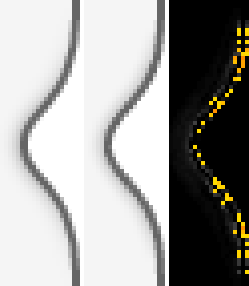 |
| `popup/left` | light | 2× | 20×71 | 10.90% | 0.62% | 1.83% |  |
| `popup/dark/left` | dark | 1× | 20×71 | 0.77% | 0.00% | 0.32% | 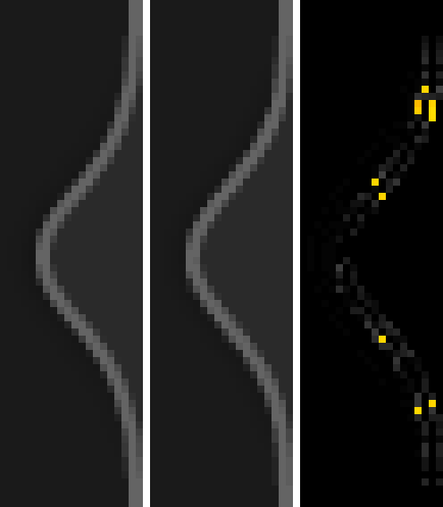 |
| `popup/dark/left` | dark | 2× | 20×71 | 4.45% | 0.05% | 0.87% | 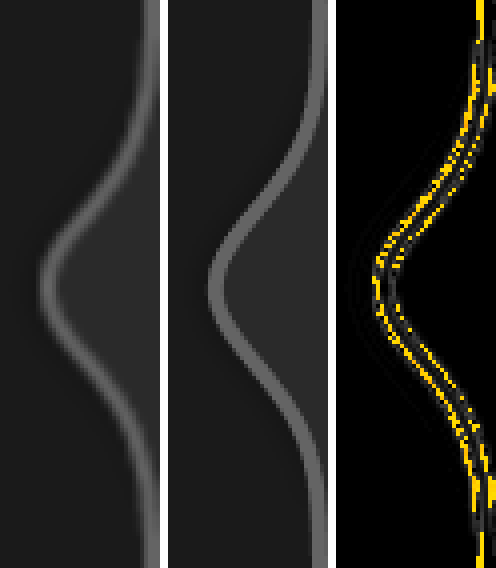 |
| `divider/left` | light | 1× | 20×71 | 5.21% | 1.69% | 1.14% | 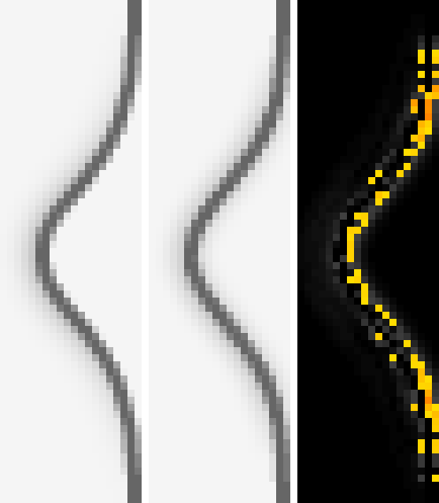 |
| `divider/left` | light | 2× | 20×71 | 9.60% | 0.49% | 1.77% | 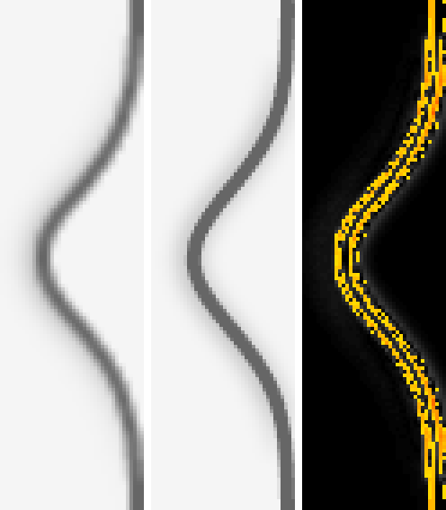 |
| `divider/left` | dark | 1× | 20×71 | 3.38% | 0.63% | 0.66% | 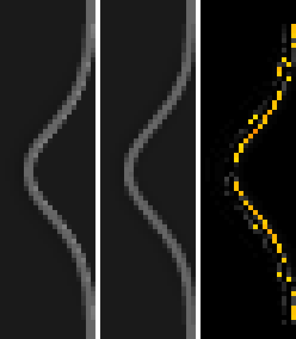 |
| `divider/left` | dark | 2× | 20×71 | 6.07% | 0.46% | 1.09% | 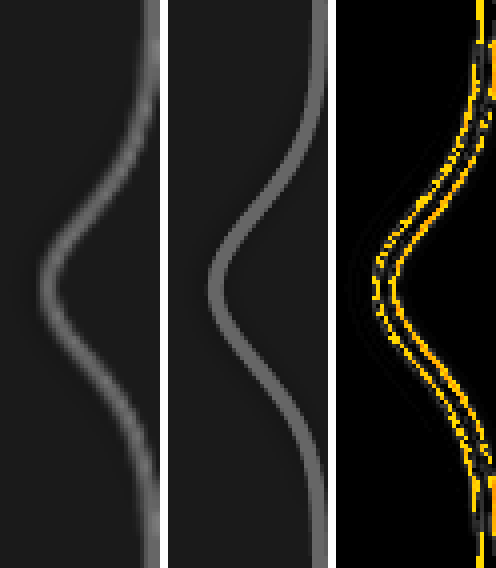 |
| `popup/right` | light | 1× | 20×71 | 4.15% | 1.13% | 0.82% |  |
| `popup/right` | light | 2× | 20×71 | 10.97% | 0.60% | 1.85% |  |
| `popup/dark/right` | dark | 1× | 20×71 | 0.85% | 0.00% | 0.33% | 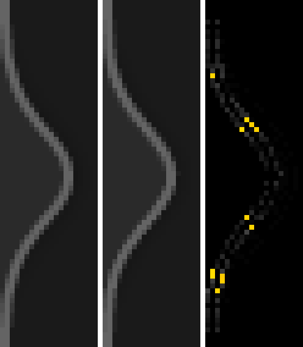 |
| `popup/dark/right` | dark | 2× | 20×71 | 4.61% | 0.07% | 0.88% |  |
| `divider/right` | light | 1× | 20×71 | 5.21% | 1.55% | 1.13% | 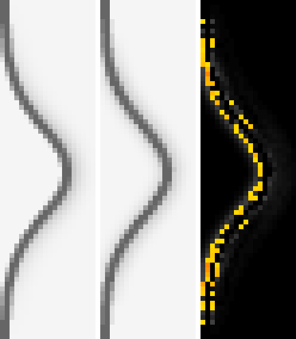 |
| `divider/right` | light | 2× | 20×71 | 9.45% | 0.48% | 1.77% |  |
| `divider/right` | dark | 1× | 20×71 | 3.66% | 0.70% | 0.68% |  |
| `divider/right` | dark | 2× | 20×71 | 6.23% | 0.48% | 1.09% | 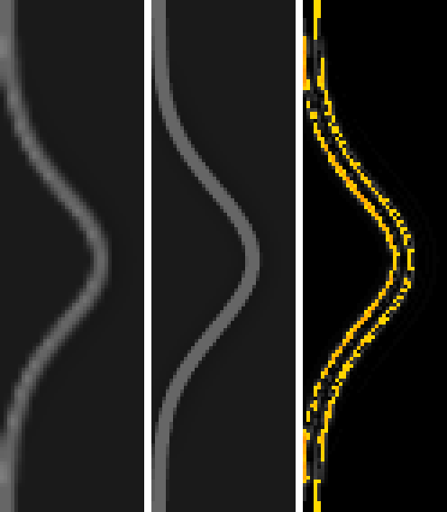 |
| `popup/top-left-corner-up` | light | 1× | 32×14 | 2.68% | 1.34% | 1.15% |  |
| `popup/top-left-corner-up` | light | 2× | 32×14 | 17.69% | 0.95% | 3.03% |  |
| `popup/dark/top-left-corner-up` | dark | 1× | 32×14 | 1.56% | 0.67% | 0.59% |  |
| `popup/dark/top-left-corner-up` | dark | 2× | 32×14 | 5.30% | 0.11% | 1.45% |  |
| `divider/top-left-corner-up` | light | 1× | 32×14 | 4.02% | 2.46% | 1.50% |  |
| `divider/top-left-corner-up` | light | 2× | 32×14 | 15.07% | 0.78% | 2.81% |  |
| `divider/top-left-corner-up` | dark | 1× | 32×14 | 7.14% | 2.46% | 1.43% |  |
| `divider/top-left-corner-up` | dark | 2× | 32×14 | 11.66% | 0.78% | 1.97% |  |
| `popup/top-right-corner-up` | light | 1× | 32×14 | 3.57% | 2.23% | 1.19% |  |
| `popup/top-right-corner-up` | light | 2× | 32×14 | 18.42% | 0.89% | 3.15% |  |
| `popup/dark/top-right-corner-up` | dark | 1× | 32×14 | 1.12% | 0.67% | 0.62% |  |
| `popup/dark/top-right-corner-up` | dark | 2× | 32×14 | 5.80% | 0.22% | 1.50% |  |
| `divider/top-right-corner-up` | light | 1× | 32×14 | 4.24% | 2.46% | 1.49% |  |
| `divider/top-right-corner-up` | light | 2× | 32×14 | 16.18% | 0.67% | 2.95% |  |
| `divider/top-right-corner-up` | dark | 1× | 32×14 | 7.37% | 2.46% | 1.42% |  |
| `divider/top-right-corner-up` | dark | 2× | 32×14 | 11.72% | 0.89% | 2.00% |  |
| `popup/bottom-left-corner-down` | light | 1× | 32×14 | 3.79% | 2.68% | 1.27% |  |
| `popup/bottom-left-corner-down` | light | 2× | 32×14 | 18.08% | 0.95% | 3.16% |  |
| `popup/dark/bottom-left-corner-down` | dark | 1× | 32×14 | 1.56% | 0.67% | 0.63% |  |
| `popup/dark/bottom-left-corner-down` | dark | 2× | 32×14 | 6.58% | 0.22% | 1.52% |  |
| `divider/bottom-left-corner-down` | light | 1× | 32×14 | 3.79% | 2.46% | 1.51% |  |
| `divider/bottom-left-corner-down` | light | 2× | 32×14 | 15.90% | 0.78% | 2.95% |  |
| `divider/bottom-left-corner-down` | dark | 1× | 32×14 | 7.14% | 2.01% | 1.46% |  |
| `divider/bottom-left-corner-down` | dark | 2× | 32×14 | 12.39% | 0.84% | 2.03% |  |
| `popup/bottom-right-corner-down` | light | 1× | 32×14 | 2.46% | 1.12% | 1.10% |  |
| `popup/bottom-right-corner-down` | light | 2× | 32×14 | 18.14% | 0.73% | 3.07% |  |
| `popup/dark/bottom-right-corner-down` | dark | 1× | 32×14 | 0.89% | 0.45% | 0.58% |  |
| `popup/dark/bottom-right-corner-down` | dark | 2× | 32×14 | 5.19% | 0.22% | 1.46% |  |
| `divider/bottom-right-corner-down` | light | 1× | 32×14 | 4.02% | 2.23% | 1.46% |  |
| `divider/bottom-right-corner-down` | light | 2× | 32×14 | 15.85% | 0.56% | 2.88% |  |
| `divider/bottom-right-corner-down` | dark | 1× | 32×14 | 7.14% | 2.68% | 1.39% |  |
| `divider/bottom-right-corner-down` | dark | 2× | 32×14 | 11.22% | 0.84% | 1.96% |  |
| `popup/top-left-corner-left` | light | 1× | 14×32 | 4.24% | 2.46% | 1.24% |  |
| `popup/top-left-corner-left` | light | 2× | 14×32 | 18.75% | 0.67% | 3.11% |  |
| `popup/dark/top-left-corner-left` | dark | 1× | 14×32 | 0.45% | 0.00% | 0.62% | 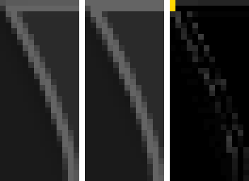 |
| `popup/dark/top-left-corner-left` | dark | 2× | 14×32 | 5.36% | 0.22% | 1.49% |  |
| `divider/top-left-corner-left` | light | 1× | 14×32 | 4.24% | 2.23% | 1.50% |  |
| `divider/top-left-corner-left` | light | 2× | 14×32 | 15.96% | 0.50% | 2.88% | 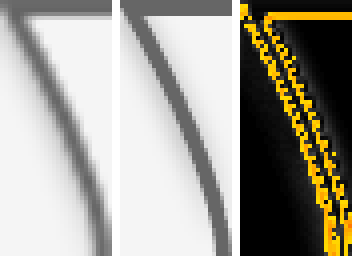 |
| `divider/top-left-corner-left` | dark | 1× | 14×32 | 6.92% | 1.79% | 1.44% | 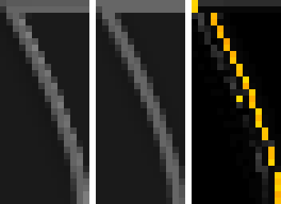 |
| `divider/top-left-corner-left` | dark | 2× | 14×32 | 11.38% | 0.84% | 1.98% |  |
| `popup/bottom-left-corner-left` | light | 1× | 14×32 | 3.57% | 2.46% | 1.22% |  |
| `popup/bottom-left-corner-left` | light | 2× | 14×32 | 18.53% | 0.95% | 3.17% | 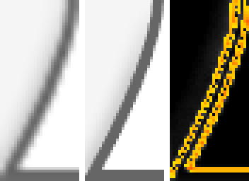 |
| `popup/dark/bottom-left-corner-left` | dark | 1× | 14×32 | 0.89% | 0.00% | 0.58% |  |
| `popup/dark/bottom-left-corner-left` | dark | 2× | 14×32 | 6.36% | 0.22% | 1.51% | 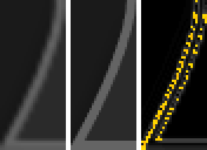 |
| `divider/bottom-left-corner-left` | light | 1× | 14×32 | 3.79% | 2.46% | 1.44% | 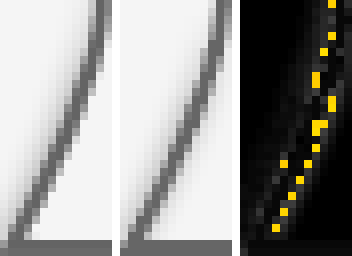 |
| `divider/bottom-left-corner-left` | light | 2× | 14×32 | 15.79% | 0.78% | 2.93% |  |
| `divider/bottom-left-corner-left` | dark | 1× | 14×32 | 7.14% | 2.01% | 1.43% | 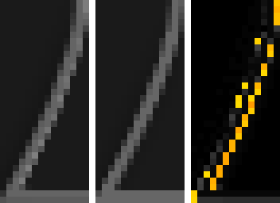 |
| `divider/bottom-left-corner-left` | dark | 2× | 14×32 | 12.33% | 0.84% | 2.03% | 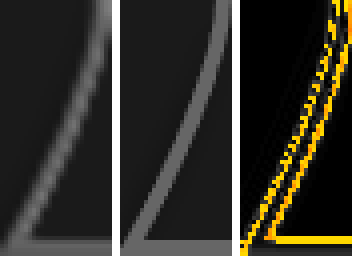 |
| `popup/top-right-corner-right` | light | 1× | 14×32 | 2.46% | 1.34% | 1.16% | 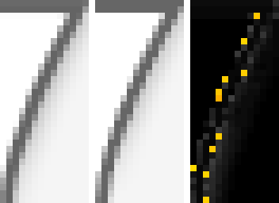 |
| `popup/top-right-corner-right` | light | 2× | 14×32 | 18.58% | 0.84% | 3.14% | 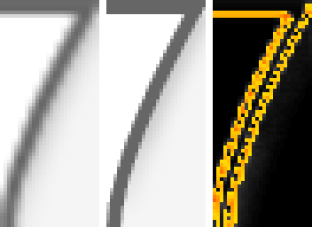 |
| `popup/dark/top-right-corner-right` | dark | 1× | 14×32 | 0.89% | 0.00% | 0.55% | 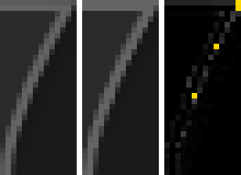 |
| `popup/dark/top-right-corner-right` | dark | 2× | 14×32 | 5.69% | 0.22% | 1.49% | 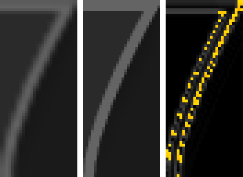 |
| `divider/top-right-corner-right` | light | 1× | 14×32 | 3.79% | 2.68% | 1.47% |  |
| `divider/top-right-corner-right` | light | 2× | 14×32 | 15.90% | 0.56% | 2.91% | 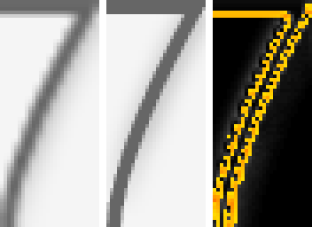 |
| `divider/top-right-corner-right` | dark | 1× | 14×32 | 6.92% | 1.79% | 1.40% | 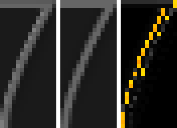 |
| `divider/top-right-corner-right` | dark | 2× | 14×32 | 11.55% | 0.89% | 1.99% | 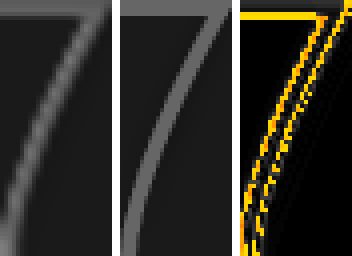 |
| `popup/bottom-right-corner-right` | light | 1× | 14×32 | 3.35% | 2.23% | 1.28% | 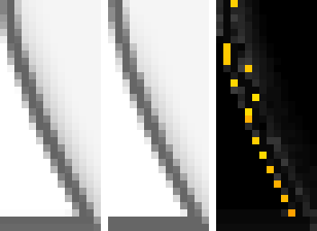 |
| `popup/bottom-right-corner-right` | light | 2× | 14×32 | 17.97% | 0.89% | 3.05% | 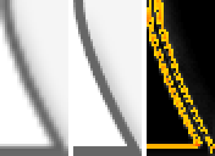 |
| `popup/dark/bottom-right-corner-right` | dark | 1× | 14×32 | 0.89% | 0.00% | 0.62% | 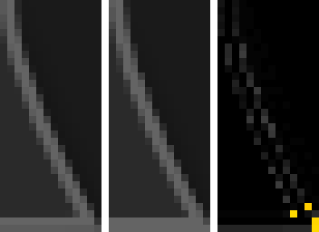 |
| `popup/dark/bottom-right-corner-right` | dark | 2× | 14×32 | 5.47% | 0.11% | 1.47% | 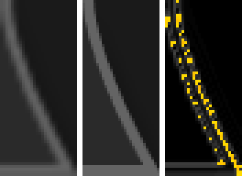 |
| `divider/bottom-right-corner-right` | light | 1× | 14×32 | 3.79% | 2.46% | 1.50% | 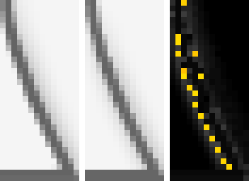 |
| `divider/bottom-right-corner-right` | light | 2× | 14×32 | 15.12% | 0.73% | 2.82% | 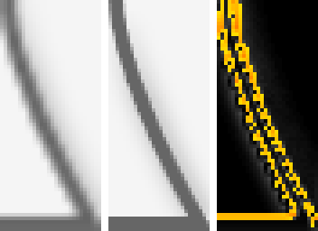 |
| `divider/bottom-right-corner-right` | dark | 1× | 14×32 | 6.70% | 1.34% | 1.47% |  |
| `divider/bottom-right-corner-right` | dark | 2× | 14×32 | 11.72% | 0.78% | 1.99% | 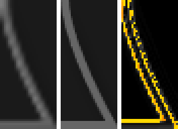 |
| `repanel/left` | light | 1× | 20×43 | 3.60% | 0.47% | 0.85% |  |
| `repanel/left` | light | 2× | 20×43 | 10.90% | 0.55% | 1.81% |  |
| `repanel/left-shadow` | dark | 1× | 20×43 | 0.12% | 0.00% | 0.29% |  |
| `repanel/left-shadow` | dark | 2× | 20×43 | 0.20% | 0.00% | 0.44% | 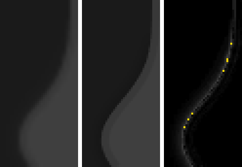 |
| `divider/div-left` | light | 1× | 320×4 | 0.00% | 0.00% | 2.19% |  |
| `divider/div-left` | light | 2× | 320×4 | 0.00% | 0.00% | 2.23% |  |
| `divider/div-right` | light | 1× | 320×4 | 0.00% | 0.00% | 2.19% |  |
| `divider/div-right` | light | 2× | 320×4 | 0.00% | 0.00% | 2.23% |  |
| `divider/div-mid` | light | 1× | 1×4 | 0.00% | 0.00% | 3.04% |  |
| `divider/div-mid` | light | 2× | 1×4 | 0.00% | 0.00% | 2.89% |  |
| `divider/div-left` | dark | 1× | 320×4 | 100.00% | 100.00% | 45.84% |  |
| `divider/div-left` | dark | 2× | 320×4 | 100.00% | 100.00% | 45.89% |  |
| `divider/div-right` | dark | 1× | 320×4 | 100.00% | 100.00% | 45.85% |  |
| `divider/div-right` | dark | 2× | 320×4 | 100.00% | 100.00% | 45.89% |  |
| `divider/div-mid` | dark | 1× | 1×4 | 100.00% | 100.00% | 66.27% |  |
| `divider/div-mid` | dark | 2× | 1×4 | 100.00% | 100.00% | 66.32% |  |

## In context

Snapshots of `context.html` (SVG foreignObject, so text uses a fallback
font).

### popups, light

### popups, dark

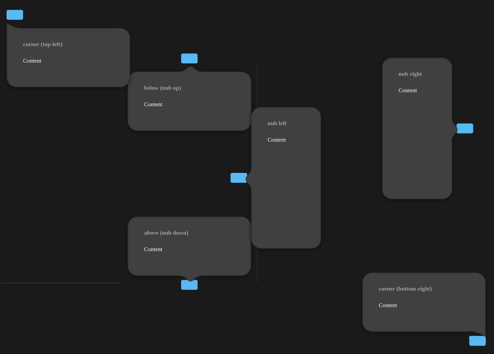

### static, light

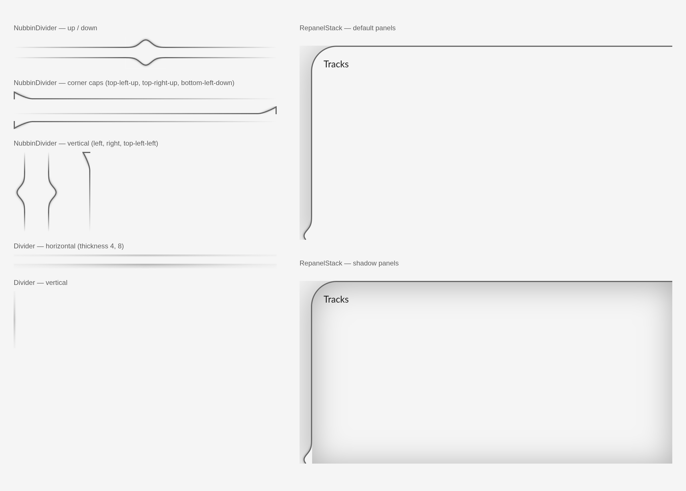

### static, dark

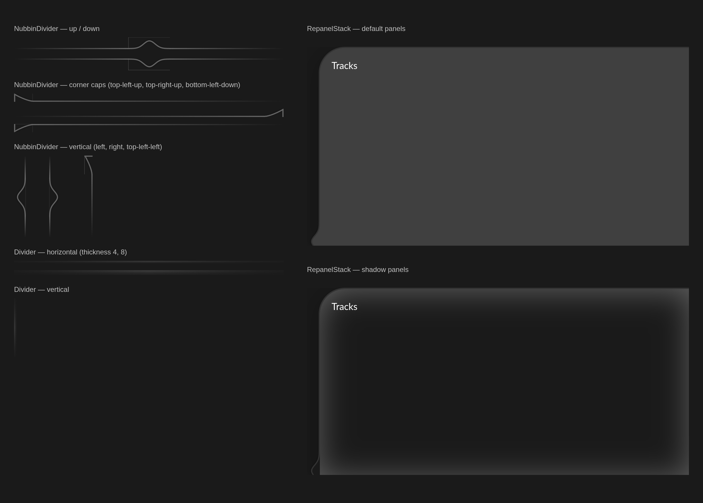
